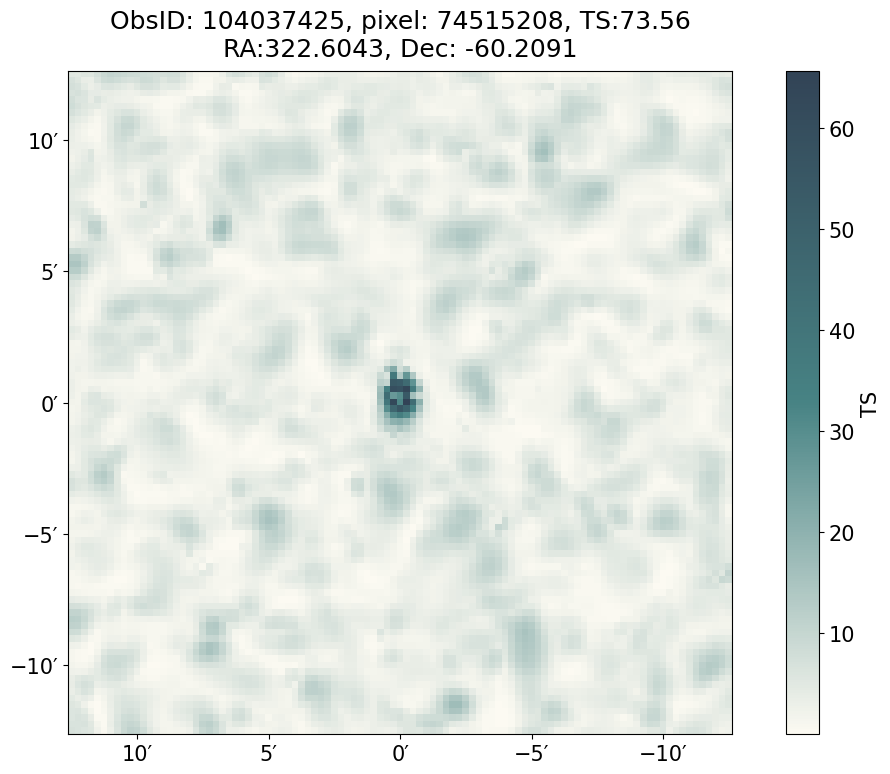
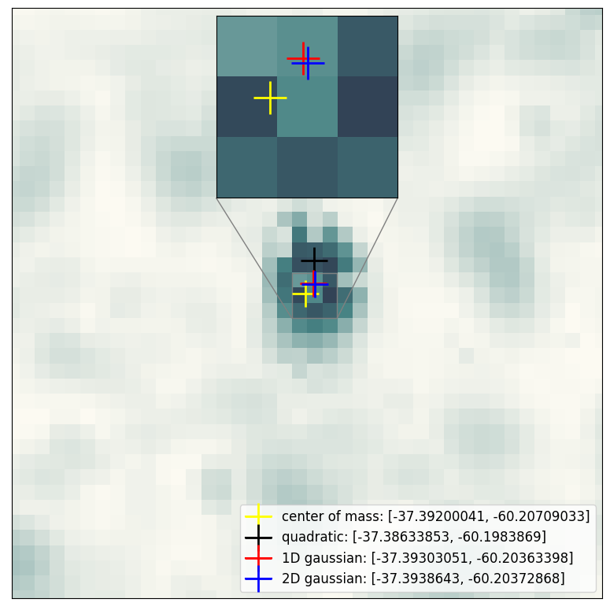
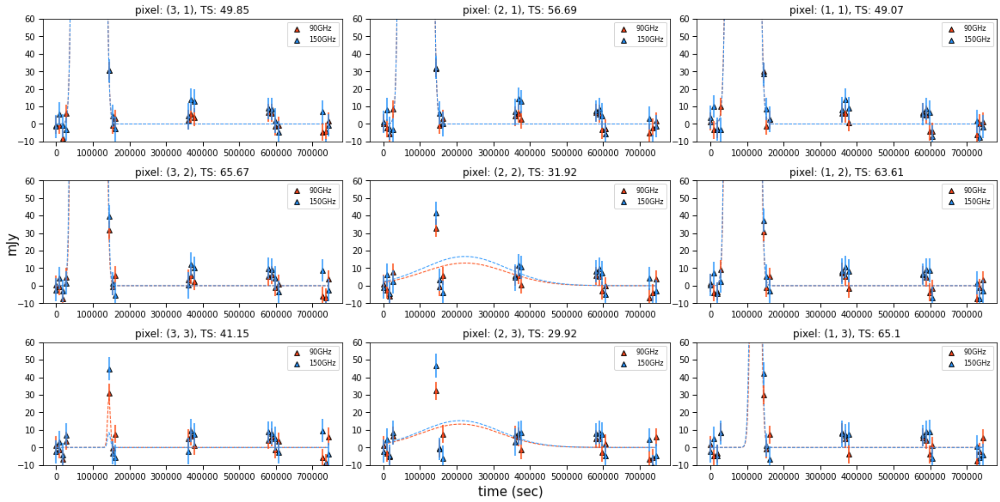
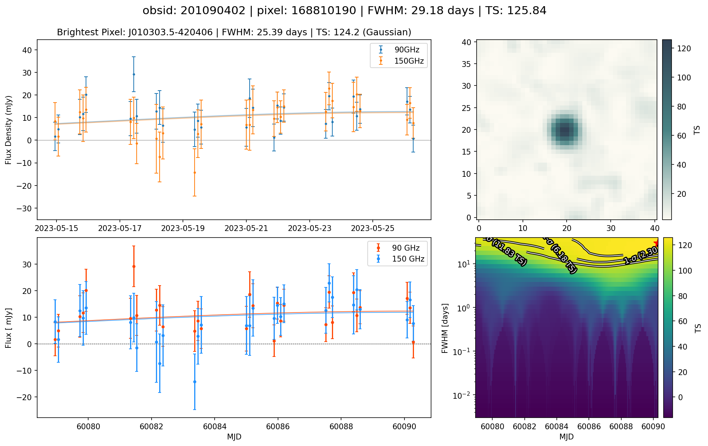
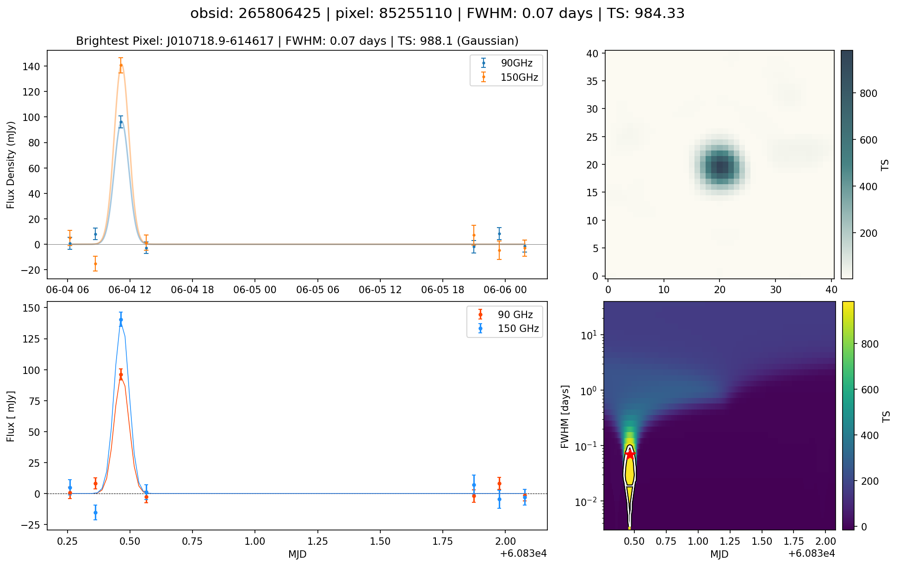
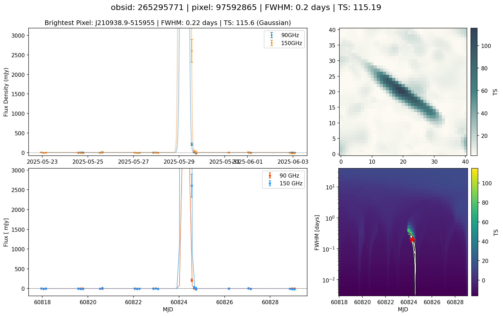

# Test Statistic fitter update

## Intro
This is an update to the South Pole Telescope's Test Statistic (TS) fitter, rewritten in Python to replace the current C++ implementation that uses the GNU Scientific Library (GSL) as fitting times were becoming a bottleneck within the pipeline. The TS is a multi-frequency band maximum-likelihood transient finding method, which quantifies the significance of a potential transient even within a given light curve (see [(Guns et al. 2021)](https://arxiv.org/pdf/2103.06166), [(Tandoi et al. 2024)](https://arxiv.org/pdf/2401.13525), [(Guns, Tandoi et al. 2026)](https://arxiv.org/pdf/2610.28633) for more info).

The TS fitter makes use of the Nelder-Mead simplex algorithm to return a best-fit Gaussian to the input light curve. In the GSL implementation, there are a few issues: 
* The Nelder-Mead method is an unbound optimizer, meaning it will explore all of the parameter space. For the context of searching for transient events within ~2 week light curves, we do not care if a 6,000,000 day FWHM fit scores slightly higher than a 6,000 day FWHM fit, as neither of those are decipherable when only looking at 14 days of data. We simply do not need to have our simplexes exploring that far out into the parameter space.
* The fits are over a 4-D parameter space: peak time (`t0`), duration (`FWHM`), and peak amplitudes (95 GHz flux density, 150 GHz flux density).
* The default implementation of the simplex is `nseeds=100`. This can sometimes run into problems where neighboring pixels have not converged on the same solution, returning "best-fits" that are different in both TS and Gaussian parameters (I expand on this with images below)

### The pixelation issue
The following images show an example of a real event that has returned a poor fit across its pixels. The first image shows the "TS map": a full thumbnail of the sky around the event, where each pixel is the TS value of that pixel's light curve across the ~2 weeks of data contained in this image.

The second image shows a zoom-in around the event, along with various methods of fitting to the central location of the event. As these events should resemble a point-source (i.e. the beam of the telescope, a 2-D Gaussian), having non-converged solutions across the pixels will lead to inaccuracies when trying to localize the source.

The third image shows the actual light curves and returned fits for the 3x3 central pixels shown in the image (note: the y-axis is inverted).

To solve for this and force the pixels to converge on the same answer, we have to brute force the algorithm by setting `nseeds=1000`, which dramatically increases the compute time to fit for these events and is very much not ideal.

## Changes
As alluded to above, we can implement a few changes to drastically cut down on compute time while maintaining accuracy:

* **Constrain the parameter search**
    * `scipy.optimize.minimize()` allows optional bounds for `method='Nelder-Mead'`, allowing us to limit the FWHM searched for
* **Perform a 2-D search to limit the parameter space**
    * The amplitudes are linear for a fixed `t0` and `FWHM`, meaning we can profile them out and search instead over a 2-D grid of only `t0` and `FWHM`, returning to solve for the amplitudes once the best-fit solution is known.
* **Initialize the optimizer with a coarse search over the parameter grid**
    * Starting off our simplex near the answer should limit how much time is spent searching
* **(Optional) secondary pass-through using known solution from brightest pixel**
    * All pixels within a flaring event should contain the same temporal information (t0, FWHM) as the neighboring pixels. This is essentially a check to make sure no pixelation occurs as we're providing the answer for the pixels to "converge" on

## Results
First a few images in different classifications of events (long-duration, short-duration, moving object such as a weather balloon or satellite) to show the Python implementation matches the GSL implementation. These images contain 4 plots:
* **Top-left**
    * Original GSL fit (with score and FWHM in sub-title)
* **Bottom-left**
    * Python implementation (with score and FWHM in image title on top)
* **Top-right**
    * Fullsize 41x41 TS map from the Python implementation
* **Bottom-right**
    * Surface map of the 2-D parameter space searched on with the Python implementation, colored by TS, with contours showing the 1-, 2-, and 3-$\sigma$ confidence intervals, and finally a red star showing the position of the best fit.

(Note: the TS values don't exactly match, but vary by ~<1%. I haven't tested this thoroughly but likely is fixed by fine-tuning the upper and lower limits of our bounded parameters. Either way we are still returning a similarly statistically significant event.)

## Conclusion

In the above images I've shown a sample of events that show the Python implementation matches the GSL implementation, but I haven't discussed the benefits, which are simple: **The Python implementation is a factor of ~250 times faster than the GSL implementation**.

For the case of `nseeds=1000`, the GSL implementation takes ~1.5s per pixel to fit. For a 41x41 TS map (1681 pixels), this takes approximately 45 minutes. The Python implementation makes a full 41x41 TS map in ~10s (~15s when using the optional second pass). Previously we have been limited to making only 11x11 central cutouts of the TS map with `nseeds=100`, and then manually going back and creating full TS maps for potentially interesting events.

This speedup addresses a critical bottleneck in the SPT transients pipeline. As events happen, it is important to be able to analyze the potential event immediately and decide whether or not to alert others within the astronomy community so they can observe the event either as it is still happening, or for the immediate afterglow. **This fix will enable the pipeline to operate faster, and is another step forward to full automation of accurate alerts.**